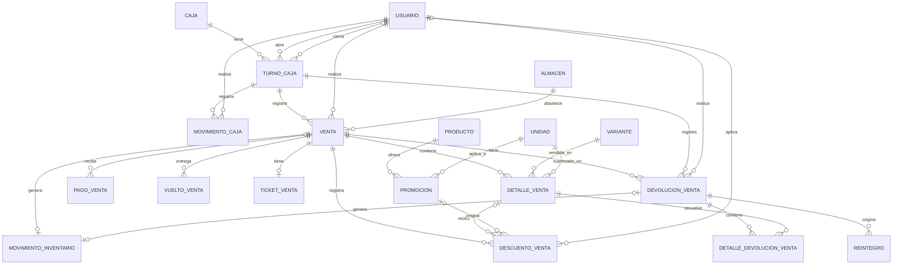

# Relaciones de entidades de ventas y caja

Este documento describe de forma conceptual las entidades de [entidies.md](entidies.md), sus relaciones y su función. Complementa los requisitos de [Ventas y promociones](ventas-y-promociones.md) y [Caja y cuadre](caja.md); no representa necesariamente tablas ya implementadas.

## Diagrama de relaciones

En el diagrama, `||` significa «exactamente uno», `o|` «cero o uno» y `o{` «cero o muchos». Por ejemplo, una caja puede tener cero o muchos turnos y cada turno pertenece a una caja. Las cardinalidades son una interpretación inicial del listado y deben validarse cuando los requisitos no las confirman.

`USUARIO`, `ALMACEN`, `PRODUCTO`, `VARIANTE`, `UNIDAD` y `MOVIMIENTO_INVENTARIO` son entidades externas al listado de ventas y caja. `CONFIGURACION_DESCUENTOS` no aparece conectada porque el listado no define una referencia directa: sus reglas se consultan al aplicar descuentos manuales. Tampoco se representa una relación directa entre producto y variante, porque pertenece al modelo de inventario.

## ¿Para qué sirve cada entidad?

### Caja y turnos

| Entidad             | Función y relaciones principales                                                                                                                                                                                                                                                             |
| ------------------- | -------------------------------------------------------------------------------------------------------------------------------------------------------------------------------------------------------------------------------------------------------------------------------------------- |
| **Caja**            | Representa una caja física identificada por código y nombre. Puede tener varios turnos sucesivos.                                                                                                                                                                                            |
| **Turno Caja**      | Registra la apertura y el cierre de una caja, los usuarios responsables, la fecha operativa y los importes del cuadre. Agrupa ventas y movimientos de caja; también identifica el turno en que se registra una devolución. El usuario de cierre puede faltar mientras el turno está abierto. |
| **Movimiento Caja** | Registra un ingreso o egreso manual de efectivo de un turno, con importe, motivo, fecha y usuario. Los cobros de ventas no se duplican como ingresos manuales.                                                                                                                               |

### Ventas y cobros

| Entidad           | Función y relaciones principales                                                                                                                                                                                                                                                  |
| ----------------- | --------------------------------------------------------------------------------------------------------------------------------------------------------------------------------------------------------------------------------------------------------------------------------- |
| **Venta**         | Representa la operación realizada por un usuario en un turno y desde un almacén. Conserva estado, fecha, subtotal, descuentos, base imponible, IGV y total; agrupa sus detalles, pagos, vueltos, descuentos, devoluciones y ticket. Puede vincularse con la salida de inventario. |
| **Detalle Venta** | Representa una línea de la venta para una variante y una unidad. Guarda cantidad, factor de conversión a unidad base, cantidad base, precio unitario y descuentos; permite relacionar descuentos y devoluciones con la línea original.                                            |
| **Pago Venta**    | Registra un importe recibido para la venta, su medio y fecha. Una venta puede combinar efectivo y Yape; el pago por Yape se declara sin verificación automática en esta versión.                                                                                                  |
| **Vuelto Venta**  | Registra el importe entregado como vuelto, su medio y fecha. Puede ser en efectivo o Yape; solo el vuelto en efectivo reduce el efectivo físico del turno.                                                                                                                        |
| **Ticket Venta**  | Representa la constancia interna de una venta, sin valor tributario. Sus datos, numeración y tratamiento ante devoluciones o anulaciones están pendientes de definir.                                                                                                             |

### Promociones y descuentos

| Entidad                      | Función y relaciones principales                                                                                                                                                                                                                                        |
| ---------------------------- | ----------------------------------------------------------------------------------------------------------------------------------------------------------------------------------------------------------------------------------------------------------------------- |
| **Promoción**                | Configura para un producto y una unidad una cantidad mínima, un tipo y valor de descuento, vigencia y estado. La regla se aplica a las variantes del producto elegibles.                                                                                                |
| **Descuento Venta**          | Registra el origen y el importe de un descuento aplicado a una venta. Puede asociarse a una línea o al total; una promoción puede ser su origen y un usuario puede identificar al responsable. La obligatoriedad del usuario según el origen está pendiente de validar. |
| **Configuración Descuentos** | Guarda el límite manual por venta y su fecha de actualización. Es una configuración única para la tienda, no una entidad vinculada directamente a cada venta en el listado.                                                                                             |

### Devoluciones y reintegros

| Entidad                      | Función y relaciones principales                                                                                                                                                                                                                             |
| ---------------------------- | ------------------------------------------------------------------------------------------------------------------------------------------------------------------------------------------------------------------------------------------------------------ |
| **Devolución Venta**         | Registra una devolución o anulación vinculada a la venta, al turno que la procesa y al usuario. Incluye tipo, motivo, importes, fecha, detalles y reintegros; puede vincularse con un movimiento de inventario. El turno puede ser posterior al de la venta. |
| **Detalle Devolución Venta** | Identifica la línea original devuelta y guarda cantidad, cantidad base e importe. Una devolución parcial puede incluir solo algunas líneas o cantidades.                                                                                                     |
| **Reintegro**                | Registra el importe devuelto al cliente, su medio y fecha. Pertenece a una devolución; el reintegro en efectivo afecta el cuadre del turno en que se entrega, no el de un turno ya cerrado.                                                                  |

## Cómo se conectan en una operación

1. Se abre un **turno** en una **caja**. Durante el turno se pueden registrar movimientos manuales de efectivo.
2. Un usuario registra una **venta** desde un **almacén**, con una o más líneas de **detalle** para variantes y unidades. La salida de inventario se vincularía con la venta.
3. Las **promociones** elegibles y los descuentos manuales se registran como **descuentos de venta**. El límite manual se consulta en la configuración de descuentos.
4. La venta registra sus **pagos** y, si corresponde, **vueltos**, y dispone de un **ticket** interno.
5. Si se devuelve mercancía o se anula la venta, se registra una **devolución**, sus **detalles** y los **reintegros**; la mercancía vuelve al almacén original. El turno de devolución puede ser distinto del turno de venta.

## Suposiciones y puntos pendientes

- El diagrama permite cero elementos en varias colecciones para describir su estructura; esto no elimina reglas de negocio como exigir detalles y un cobro válido para confirmar una venta.
- La relación de venta con ticket se muestra como cero o uno, y la relación con movimientos de inventario como opcional y de hasta uno por operación: son interpretaciones del listado, no decisiones definitivas sobre emisión o persistencia.
- El listado no incluye explícitamente un `id` para **Venta**. Debe definirse su identificador antes de diseñar claves y tablas.
- Deben confirmarse la obligatoriedad de las relaciones, el vínculo exacto con inventario, la representación de anulaciones y la asignación del turno a los reintegros, especialmente si se entregan después del registro de la devolución.
- Las reglas de concurrencia de promociones, reparto de descuentos e IGV, redondeo y devoluciones sucesivas siguen pendientes según [Ventas y promociones](ventas-y-promociones.md#pendientes-de-validar).
