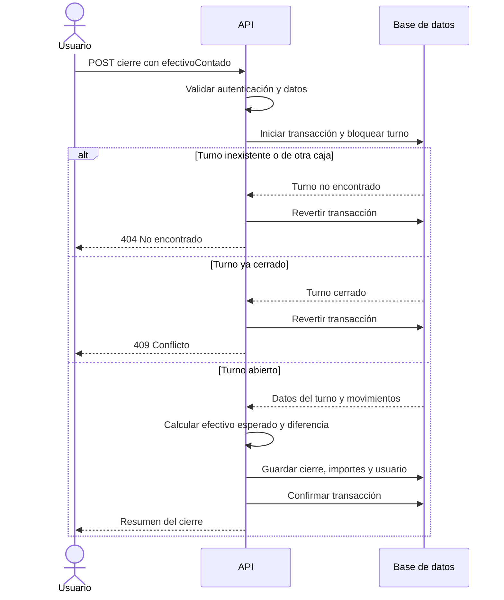

# SPEC 01 — Cierre de turno de caja

> **Estado:** Aprobado  
> **Dependencias:** Ninguna  
> **Fecha:** 2026-10-31  
> **Objetivo:** Permitir que un usuario autenticado cierre un turno de caja registrando el efectivo contado y calculando la diferencia.

## Alcance

**Incluye:**

- Agregar `POST /api/cajas/:cajaId/turnos/:turnoId/cierre` al controlador de turnos existente.
- Recibir el efectivo contado, calcular el efectivo esperado y registrar el cierre de tipo `turno`.
- Devolver un resumen del cierre y manejar los errores de identificación y estado del turno.
- Garantizar que dos solicitudes simultáneas no cierren el mismo turno dos veces.
- Documentar el endpoint y verificar su comportamiento mediante pruebas.

**Fuera de alcance:**

- El cierre de día y sus reglas específicas.
- El desglose del efectivo por denominaciones.
- Condiciones adicionales de cierre, como la ausencia de ventas pendientes.
- Cambios de roles o permisos adicionales para restringir quién cierra.

## Modelo de datos

Se reutiliza `TurnoCaja`, sin agregar estructuras persistentes ni migraciones. El cierre guarda en la misma transacción `fechaCierre`, `usuarioCierre`, `efectivoEsperado`, `efectivoContado`, `diferencia` y `tipoCierre: turno`. El usuario de cierre se obtiene de la autenticación existente; no se recibe en el cuerpo.

El cuerpo contiene `efectivoContado` como cadena decimal no negativa, con hasta dos decimales y compatible con `numeric(18,2)`. Se acepta cero. Los importes se calculan sin pérdida de precisión decimal y se persisten con dos decimales.

El efectivo esperado se calcula como saldo inicial más pagos de venta en efectivo, menos vueltos y reintegros en efectivo, más ingresos de caja y menos egresos de caja, usando los mismos criterios que `ListarCajasHandler`. La diferencia es `efectivoContado - efectivoEsperado`; tanto faltantes como sobrantes permiten cerrar.

El resumen de respuesta contiene los identificadores de caja y turno, la fecha y el usuario de cierre, el saldo inicial, el efectivo esperado, el efectivo contado, la diferencia y el tipo de cierre. Los importes se representan como cadenas decimales.

## Flujo de cierre

El bloqueo evita que dos solicitudes cierren simultáneamente el mismo turno: la segunda encontrará el turno cerrado y recibirá `409`.

## Plan de implementación

1. Agregar el esquema de entrada y sus pruebas en `src/features/sales/caja-turnos/dto/`, siguiendo la validación decimal de apertura y rechazando propiedades adicionales.
2. Incorporar el comando y el handler de cierre en `src/features/sales/caja-turnos/commands/cerrar-turno/`, con pruebas del cálculo, validaciones, persistencia y concurrencia. Usar `UnitOfWork` y el `EntityManager` transaccional para bloquear el turno, calcular los importes y guardar el cierre de forma atómica.
3. Registrar el handler en `src/features/sales/sales.module.ts` y agregar el endpoint a `src/features/sales/caja-turnos/controllers/caja-turno.controller.ts`, con su documentación Swagger y pruebas del controlador.
4. Comprobar que el listado existente devuelva el efectivo contado guardado y que la apertura posterior pueda heredar ese importe, mediante pruebas de integración de los comportamientos existentes.

## Criterios de aceptación

- [x] Un usuario autenticado puede cerrar un turno abierto perteneciente a la caja indicada mediante el endpoint especificado.
- [x] Se acepta `efectivoContado` igual a cero o positivo, con hasta dos decimales y dentro de la precisión de la columna; se rechazan importes negativos, inválidos, fuera de rango o con más decimales y propiedades adicionales.
- [x] El efectivo esperado usa la fórmula y los filtros del listado de cajas para el turno cerrado.
- [x] La diferencia se calcula como efectivo contado menos esperado, incluyendo correctamente sobrantes, faltantes y cero.
- [x] El cierre guarda juntos la fecha, el usuario autenticado, los importes, la diferencia y el tipo `turno`; si ocurre un error, no queda un cierre parcial.
- [x] La respuesta contiene el resumen descrito en el modelo de datos.
- [x] Si el turno no existe o no pertenece a la caja indicada, se responde `404` sin modificar datos.
- [x] Si el turno ya está cerrado, se responde `409` sin modificar el cierre existente.
- [x] Ante dos cierres simultáneos del mismo turno, solo uno se registra y el otro recibe `409`.
- [ ] El listado de cajas devuelve el efectivo contado del turno cerrado y un turno posterior del mismo día puede heredarlo como saldo inicial.
- [x] El endpoint aparece documentado en Swagger y las pruebas relevantes y la compilación pasan.

## Decisiones tomadas y descartadas

- **Sí:** cierre de tipo `turno` únicamente; el cierre de día requiere una definición separada.
- **Sí:** cualquier usuario autenticado puede cerrar; se registra su identidad en el turno.
- **Sí:** identificar caja y turno en la ruta; se valida su pertenencia.
- **Sí:** recibir solo el efectivo contado y calcular el esperado en el servidor con la fórmula existente.
- **Sí:** permitir diferencias con signo; no se exige coincidencia para cerrar.
- **Sí:** usar una transacción y resolver cierres simultáneos con un único ganador.
- **No:** exigir la ausencia de ventas u otras operaciones pendientes como condición adicional.

## Riesgos identificados

| Riesgo                                                                           | Mitigación                                                                                                               |
| -------------------------------------------------------------------------------- | ------------------------------------------------------------------------------------------------------------------------ |
| El cálculo del cierre diverge del listado de cajas.                              | Verificar ambos contra la misma fórmula y los mismos filtros de operaciones.                                             |
| Una operación monetaria concurrente altera el saldo mientras se cierra el turno. | Revisar la coordinación transaccional de las operaciones existentes y cubrir el comportamiento aplicable en las pruebas. |
| El uso de números de punto flotante produce diferencias de centavos.             | Utilizar aritmética decimal exacta y comprobar los resultados en las pruebas.                                            |

## Qué no incluye esta especificación

- Cierre de día.
- Desglose por denominaciones.
- Validaciones de operaciones pendientes o nuevos permisos.
